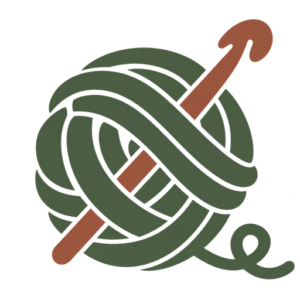

# Loop

[Use Loop](https://whickmott.github.io/loop/)

A crochet visualiser. Write a pattern, choose your yarn and explore the result in 3D. Follow the construction stitch by stitch to see how the fabric fits together.

- US and UK crochet terms, nested repeats, increases, decreases and counted turning chains.
- Cables, front and back post stitches, chain spaces and work in rows or rounds.
- Yarn weights, hook sizes, measured gauge, colours and marled yarn.
- Follow the pattern stitch by stitch, or collapse the panel for a larger view.
- Save and open projects, export images and use Loop on desktop or mobile.

## Use Loop

Open [Loop](https://whickmott.github.io/loop/), choose an example, then edit the pattern and press Preview pattern or Ctrl + Enter. Examples load suitable yarn settings and a useful starting view. The Pattern guide explains the complete language, including US and UK terminology.

Drag to rotate, scroll to zoom and Shift-drag to pan. Use Front for pixel art, or turn the fabric to inspect its loops, posts and cable crossings. Collapse Follow the pattern when you want a larger view.

Projects are remembered in your browser when storage is available. Use Save to keep a project file you can open again later. The crochet preview is approximate; use a real swatch to check your gauge.

## Examples

- First swatch and counted turning chains: foundations, turns, repeats and consistent stitch counts.
- Ribbed cuff, alternating ribbing and basketweave: loop placement, stitch heights and post texture.
- Open mesh, shell lace and crossed stitches: chain spaces, shared targets and returning to skipped stitches.
- Opposing rope cables: front and back crossings with post-stitch return rows.
- Shaped diamond, round coaster and little basket: increases, decreases, joined rounds and the transition from a flat base to upright walls.
- Pixel heart and robot: two- and six-colour slip-stitch charts with correctly reversed return rows.

Loop runs in your browser. A browser with WebGL support and an internet connection are required.
